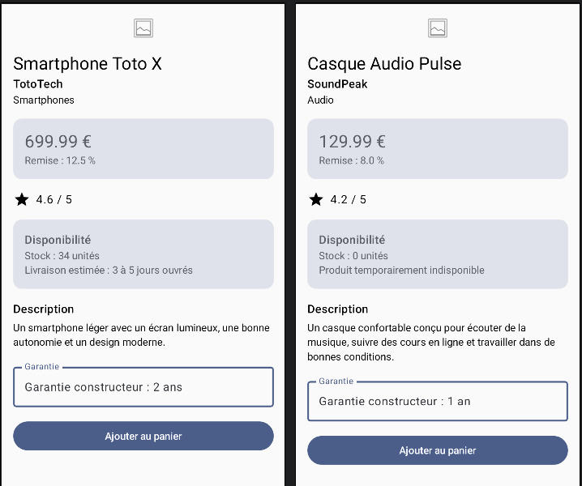

# Product Explorer

Application Android développée avec **Kotlin** et **Jetpack Compose** dans le cadre de l'atelier « Développement Android avec Jetpack Compose ».

Product Explorer est le projet fil rouge du bloc 2 : il démarre au TP4 et s'enrichit à chaque TP. Les données sont locales (aucun appel réseau pour l'instant).

## Progression

| TP | Thème | Contenu |
|----|-------|---------|
| TP4 | Composants fondamentaux | Écran de détail produit |

---

## TP4 – Écran de détail produit

**Objectif :** afficher la fiche détaillée d'un produit avec les composants fondamentaux de Compose.

**Ce qui a été fait :**
- Modèle de données local `ProductUi` et deux produits d'exemple (`sampleProduct()`, `sampleProductOutOfStock()`).
- Écran `ProductDetailScreen` qui assemble des composants réutilisables :
  - `ProductImage` : `Image` + `painterResource` + `contentDescription` (accessibilité) ;
  - `ProductHeader` : titre, marque, catégorie avec `MaterialTheme.typography` ;
  - `ProductPriceCard` et `ProductAvailabilityCard` : informations regroupées dans des `Card` ;
  - `ProductRating` : `Icon` (étoile) + `Text` dans une `Row` ;
  - `ProductDescription` : section titre + texte ;
  - `ProductWarrantyField` : `OutlinedTextField` en lecture seule ;
  - `AddToCartButton` : `Button` qui reçoit un callback `onClick`.
- Ajout de la dépendance `material-icons-extended` via le Version Catalog (`libs.versions.toml`).
- Deux previews : produit en stock et produit en rupture de stock.

**Notions :** `Text`, `Button`, `Icon`, `Image`, `Card`, `TextField`, `Modifier`, callbacks, `@Preview`.

